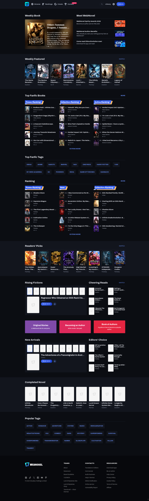
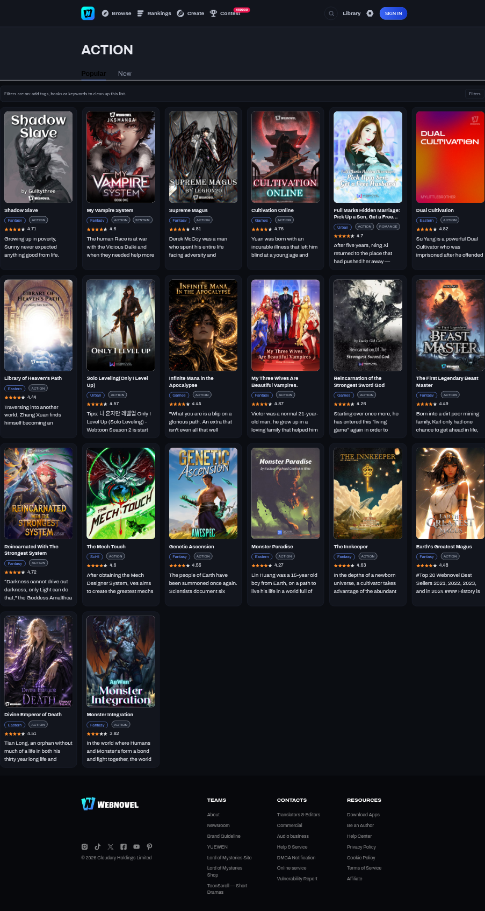
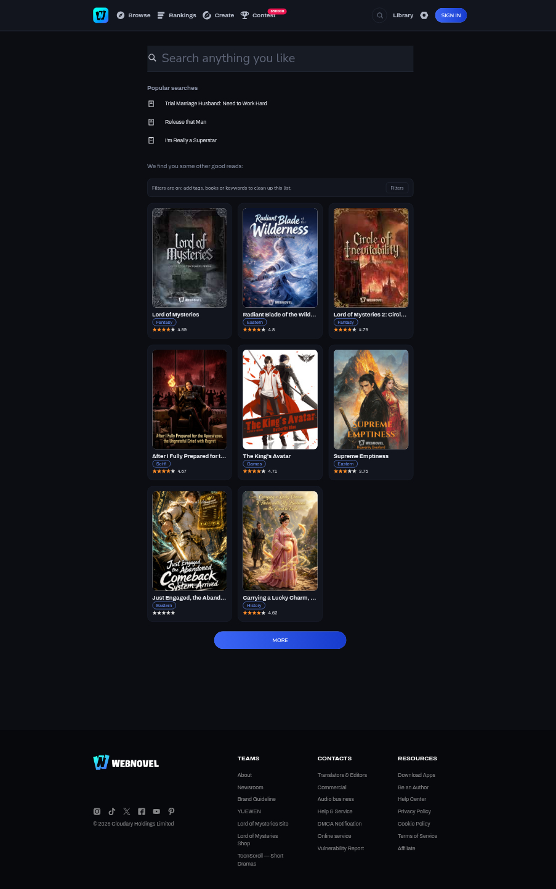
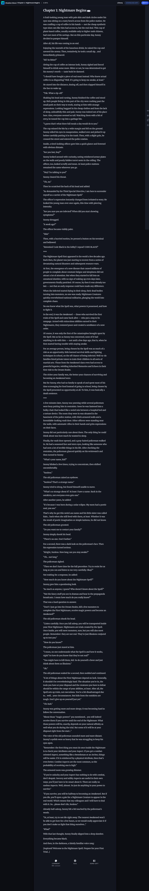

# WebNovel Dark & Enhanced

A Chrome extension (Manifest V3) that makes [webnovel.com](https://www.webnovel.com) comfortable to read:
a real dark theme for every page, a decluttered layout, a card-based listing view, tag/book filters and a
reader with typography controls, chapter hotkeys and progress memory.

It rebuilds the ideas from two earlier userscripts into a single extension so the theme, filters and
reader settings survive navigation and apply across the whole site:

- [WebNovel Enhanced Dark + Filter Styling](https://gist.github.com/Gishi1/639159d6c4757fb26fc9262d482b7e26)
- [WebNovel genre and paywall filter](https://gist.github.com/Gishi1/fc7c69aa994b3eebfe01e2d2b489ecd2)

## Features

### Theme
- Dark theme built on the site's own CSS custom properties, so it also covers lazy-loaded chunks,
  dialogs, dropdowns and the reader.
- Three palettes: **Dark**, **Midnight** (pure black) and **Dim** (softer contrast).
- Four accent colours: blue, violet, teal, rose.
- Optional image dimming.
- No `filter: invert()` tricks: covers, badges and brand colours stay intact.

### Cleanup
- Cookie consent wall (Didomi) and its scroll lock.
- "Download Webnovel APP" floating card.
- Empty AdSense slots between sections.
- Coin / "get more coins" promo modals.
- Header `title` tooltips and the paragraph-comment onboarding tip.

### Listings
- `/stories`, `/tags/*` and search results become a responsive cover grid instead of cramped
  two-column rows with fixed inline heights.
- Covers keep their 3:4 aspect ratio; titles, tag chips, descriptions and ratings are laid out as cards.
- Optional "match" badge showing how many of your preferred tags a book has.
- Quick-hide button on each card (adds the book to the block list).

### Filters
Rules run locally on every listing; nothing leaves the browser.
- Hide books by tag (e.g. `yaoi`, `tragedy`).
- Prefer tags (adds a match badge).
- Block books by numeric id, slug or full URL.
- Block authors (book pages).
- Hide descriptions containing keywords.
- Minimum rating.
- Filtered books are either dimmed or removed; a summary bar shows the count and can reveal them again.
- Per-card "hide" writes to the block list.

### Reader
- Width (narrow / medium / wide / full), font family (serif / sans / system), font size and line height.
- Justify text, hide paragraph-comment markers, thin reading-progress bar.
- `←` / `→` navigate chapters, `+` / `−` change the font size.
- Remembers your scroll position per book when you come back to a chapter.
- Works alongside the site's own display-options dialog.

### Popup & options
- Popup with a master switch, theme picker, quick toggles, filter summary and page context.
- Options page with all settings, chip editors for tag lists, book/author/keyword lists,
  JSON export/import and reset.

## Screenshots

| Home | Listing |
| --- | --- |
|  |  |

| Search | Reader |
| --- | --- |
|  |  |

## Install (unpacked)

1. Open `chrome://extensions` (or `brave://extensions`).
2. Enable **Developer mode**.
3. Choose **Load unpacked** and select this directory.
4. Visit webnovel.com. The theme is on by default; use the toolbar popup to change it.

Chrome 137+ stable ignores `--load-extension` for manual launches, but **Load unpacked** in
`chrome://extensions` still works. For automated testing the repo uses Brave under Xvfb
(see `tools/`), which still honours the flag.

## Permissions

| Permission | Why |
| --- | --- |
| `storage` | Save settings and scroll positions locally. |
| `https://www.webnovel.com/*` | Inject the theme and scripts on the site only. |

No analytics, no remote code, no network requests except the site's own chapter catalogue page
when you press a chapter-navigation hotkey.

## Keyboard shortcuts

| Shortcut | Action |
| --- | --- |
| `Alt+Shift+D` | Toggle the dark theme |
| `Alt+Shift+O` | Open settings |
| `←` / `→` (reader) | Previous / next chapter |
| `+` / `−` (reader) | Increase / decrease font size |

## How it works

```
manifest.json
src/
  background.js            service worker: defaults, commands, options shortcut
  common/
    defaults.js            settings schema + early theme hint (localStorage)
    util.js                DOM/URL helpers, page-type detection
    settings.js            chrome.storage.local store with live listeners
  content/
    main-world.js          MAIN-world history hook for SPA navigation
    theme.js               toggles data-wne-theme / accent attributes
    cleanup.js             removes consent, ads, nags, tooltips
    listing.js             card parsing, filtering, badges, filter bar
    reader.js              typography, progress, hotkeys, scroll memory
    core.js                boot, observers, route changes
  styles/
    theme.css              palette + site-variable overrides
    listing.css            card grid
    reader.css             reader chrome (progress, toast)
    ui.css                 filter bar and block notice
  popup/                   toolbar popup
  options/                 full settings page
icons/                     generated PNGs
tools/                     development only (CDP drivers, screenshots, audits)
```

The theme overrides the site's `:root` colour variables under `html[data-wne-theme]`. That selector has
higher specificity than the site's `:root`, so it wins regardless of stylesheet order. A small set of
hardcoded `#fff`/`#000` rules (reader page, tab bars, pagination) is overridden explicitly.

Client-side navigation is detected with a MAIN-world `pushState`/`replaceState` hook that dispatches a
`wne:navigation` event, plus a cheap URL backstop. All content-script modules are plain scripts sharing
one `WNE` namespace so no build step is required.

## Development

The `tools/` folder drives a real browser over the Chrome DevTools Protocol (Node 22+):

```sh
# Launch Brave with the unpacked extension under Xvfb (port 9225)
./tools/restart-browser.sh https://www.webnovel.com/stories

# Navigate, evaluate a check script, screenshot, print console errors
node tools/verify.mjs <url> <check.js> <out.png> [waitMs]

# WCAG contrast audit of the current page
node tools/verify.mjs <url> tools/contrast.js out.png

# Regenerate icons
node tools/make-icons.mjs
```

`tools/contrast.js` walks every visible text element, composites its background and reports WCAG AA
failures. Current status across home, listings, book page and reader: only the site's own contest badge
(`$50000`, 4.42:1) is below AA.

## Limitations

- Does not bypass paywalls, locked chapters, coins or ads for account perks. It only changes presentation.
- Logged-in-only surfaces (library, profile) are styled by the same global theme but were not part of the
  automated visual regression set because the test browser is signed out.
- The site can change class names or CSS variables at any time; the theme is centralised in
  `src/styles/theme.css` so fixes stay small.
- Reader chapter navigation depends on fetching `/book/<id>/catalog`; if the site rate-limits that page,
  the arrow keys fall back to a toast instead of navigating.
