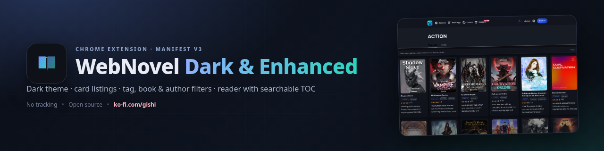
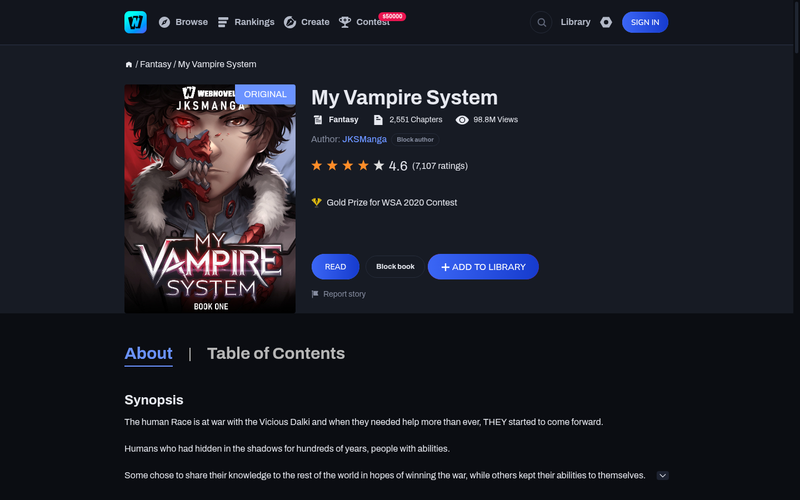
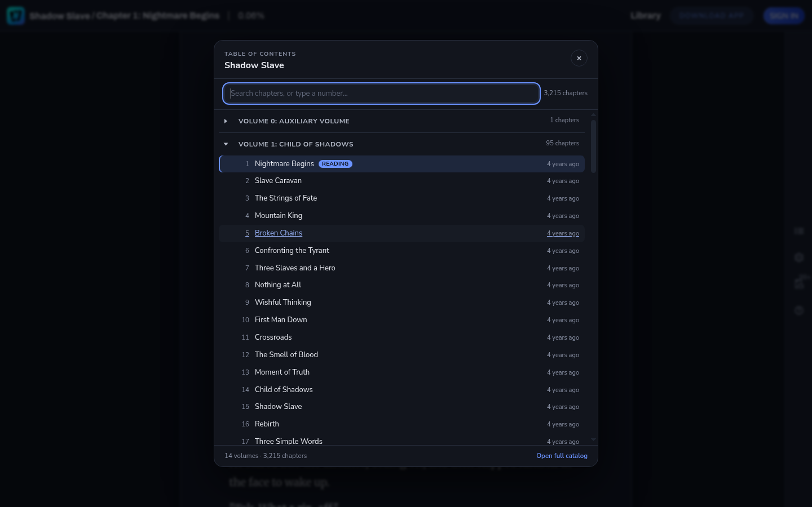
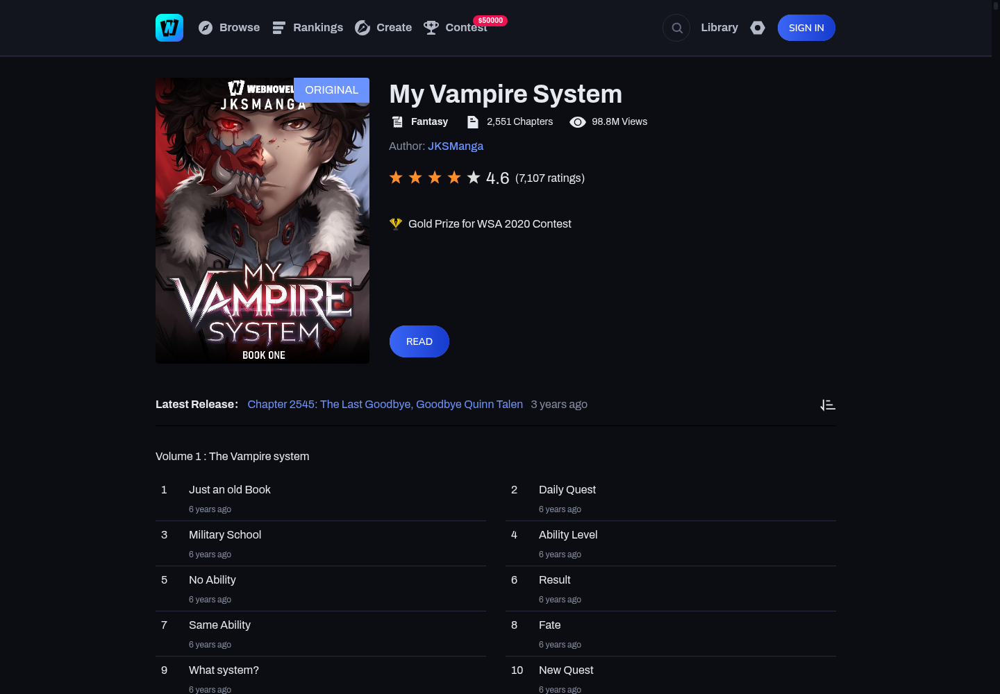

<div align="center">



# WebNovel Dark & Enhanced

**A Chrome extension that makes [webnovel.com](https://www.webnovel.com) comfortable to read.**
Dark theme · card listings · tag, book and author filters · a reader with a searchable table of contents.


[](https://ko-fi.com/gishi)

</div>

---

## Table of contents

- [Why this exists](#why-this-exists)
- [Features](#features)
- [Screenshots](#screenshots)
- [Install](#install)
- [Usage](#usage)
- [Permissions and privacy](#permissions-and-privacy)
- [How it works](#how-it-works)
- [Development](#development)
- [Troubleshooting](#troubleshooting)
- [Support](#support)
- [Credits](#credits)
- [License](#license)

## Why this exists

WebNovel's reader is functional, but the site is bright, the listings are cramped two-column rows and the
catalogue dialog never finishes loading. This extension fixes the parts that get in the way of reading:

- a **real dark theme** across every page, built on the site's own CSS variables instead of `invert()` hacks;
- a **card grid** for listings instead of fixed-height rows;
- **filters** you can control from the page itself — hide tags, prefer tags, block books and authors;
- a **reader** with comfortable typography, chapter hotkeys, reading progress and a working table of contents.

It is an unofficial fan project and is not affiliated with WebNovel or Cloudary.

## Features

### Theme
- **Dark**, **Midnight** (pure black) and **Dim** palettes, plus blue, violet, teal and rose accents.
- Covers the header, listings, search, book pages, the catalogue, dialogs, dropdowns and the reader.
- Optional image dimming; no inverted images or broken brand colours.

### Cleanup
- The Didomi cookie consent wall (and its scroll lock).
- The "Download Webnovel APP" floating card.
- Empty AdSense slots, coin promos and the paragraph-comment onboarding tip.
- Header `title` tooltips that pop up over navigation.

### Listings
- `/stories`, `/tags/*` and search results become a responsive cover grid, capped at **five books per row**
  so wide monitors don't stretch cards across the screen.
- Cards keep the 3:4 cover ratio with titles, tag chips, descriptions and ratings.
- Optional match badge showing how many preferred tags a book has.
- Each card's corner button **blocks or unblocks** the book (`×` / `↺`).

### Filters
Everything is local and editable from the site:

| Where | What you can do |
| --- | --- |
| **Tag chip** (listing cards, book pages) | Hide this tag · Prefer this tag · Open tag page |
| **Tag page** (`/tags/<tag>`) | Hide / Prefer buttons under the title |
| **Book page** | Block author (next to the author) · Block book (next to READ) |
| **Filter bar** | Show all · Remove filtered / Dim filtered · open settings |
| **Toolbar popup** | Master switch, theme, quick cleanups, remove-filtered toggle |
| **Options page** | Full lists, keyword and rating filters, import/export |

- Filtered books are **dimmed** or **removed** — toggle between the two from the filter bar or popup.
- Block lists accept numeric ids, slugs, `/book/<slug>_<id>` paths or full URLs.
- Blocking an author also hides the book you are on, because listing cards don't expose author names.

### Reader
- Page width (narrow / medium / wide / full), font family, font size and line height.
- Justify text, hide paragraph-comment markers, thin progress bar and per-book scroll memory.
- `←` / `→` move between chapters (uses a cached chapter list), `+` / `−` change font size.
- **Searchable table of contents** with volume grouping, locked badges, current-chapter marker and
  type-to-filter. The catalogue is prefetched while you read, so the dialog opens instantly.

### Extras
- Settings live in `chrome.storage.local`; export/import from the options page.
- `Alt+Shift+D` toggles the theme, `Alt+Shift+O` opens settings.
- No analytics, no remote code, no tracking.

## Screenshots

| Home | Listings |
| --- | --- |
|  |  |

| Book page | Reader |
| --- | --- |
|  |  |

| Table of contents | Catalogue |
| --- | --- |
|  |  |

| Search |
| --- |
|  |

## Install

Requirements: **Chrome 111+**, **Edge 111+** or **Brave** (Manifest V3 and `world: "MAIN"` content scripts).
No build step, no dependencies.

### Load unpacked (recommended)

1. **Get the code**
   - Download this repository: **Code → Download ZIP**, then extract it, or
   - `git clone <this-repository-url>` and `cd` into the folder.
2. Open the extensions page for your browser:
   - Chrome: `chrome://extensions`
   - Edge: `edge://extensions`
   - Brave: `brave://extensions`
3. Turn on **Developer mode** (top-right toggle).
4. Click **Load unpacked** and select the folder that contains `manifest.json`
   (the repository root — not the `src` folder).
5. Pin **WebNovel Dark & Enhanced** from the puzzle-piece menu.
6. Open [webnovel.com](https://www.webnovel.com) — the dark theme is on by default.

> **After updating the extension files**, open the extensions page and click **Reload** on the card,
> then refresh the WebNovel tab. Chrome caches unpacked content scripts until the extension is reloaded.

### From a release zip

Download `webnovel-dark-enhanced-<version>.zip` from the releases page (or build it with
`./tools/package.sh`), extract it, then follow the **Load unpacked** steps above on the extracted folder.

### First run

Click the toolbar icon to open the popup. The master switch, theme and quick toggles apply instantly
to every open WebNovel tab. Everything else lives in **All settings**.

## Usage

### Theme

Open the popup or **All settings → Appearance**:
- **Theme**: Off, Dark, Midnight, Dim.
- **Accent**: blue, violet, teal, rose.
- **Dim cover images** for late-night reading.

### Filtering

- Click any **tag chip** on a card or a book page: choose **Hide**, **Prefer** or open the tag page.
  Hidden tags get a red strikethrough; preferred tags get an amber underline.
- On a tag page, use **Filter this tag → Hide / Prefer**.
- On a book page, use **Block author** and **Block book**; the buttons toggle back to unblock.
- Use the filter bar above a list to **Show all** matches or switch between removing and dimming them.
- Manage every list, plus keyword and minimum-rating filters, in **All settings → Filters**.
- Only the book's own tags are used; nothing is fetched from other sites.

### Reader

| Shortcut | Action |
| --- | --- |
| `←` / `→` | Previous / next chapter |
| `+` / `−` | Increase / decrease font size |
| `Esc` | Close the table of contents |

The table-of-contents button in the reader toolbar opens the enhanced dialog. Type part of a chapter
title, or an exact chapter number, to filter.

## Permissions and privacy

| Permission | Why it is needed |
| --- | --- |
| `storage` | Save your settings and per-book reading positions locally. |
| `https://www.webnovel.com/*` | Inject the theme and scripts on WebNovel only. |

- No analytics, telemetry, ads or remote code.
- The only network request the extension makes on its own is a same-origin fetch of
  `/book/<id>/catalog` (the chapter list) when you use the TOC or chapter hotkeys.
- Settings never leave your browser; use **Export settings** if you want a backup.

## How it works

```text
manifest.json                 MV3 manifest (content scripts, popup, options, commands)
src/
  background.js               defaults, keyboard commands, options shortcut
  common/
    defaults.js               settings schema + first-paint theme hint
    util.js                   DOM/URL helpers, exact book matching, page detection
    settings.js               chrome.storage.local store with live change events
  content/
    main-world.js             MAIN-world history hook for SPA navigation
    theme.js                  toggles data-wne-theme / accent attributes
    cleanup.js                consent, ads, nags, tooltips
    catalog.js                shared chapter-catalogue fetch/parse + cache
    listing.js                card grid, filters, filter bar, block toggles
    reader.js                 typography, progress, hotkeys, scroll memory
    toc.js                    searchable table of contents
    inline.js                 tag menu, tag-page buttons, author/book buttons
    core.js                   boot, observers, route changes
  styles/                     theme, listing, reader, toc, inline, ui
  popup/ , options/           toolbar popup and settings page
icons/                        generated PNG icons
tools/                        development only (browser drivers, audit, packaging)
```

The theme re-declares the site's `:root` colour variables under `html[data-wne-theme]`, which wins by
specificity regardless of stylesheet order; a short list of hardcoded `#fff`/`#000` rules is overridden
explicitly. Client-side navigation is detected with a MAIN-world `pushState` hook plus a URL backstop.
All content modules are plain scripts sharing one `WNE` namespace, so there is no bundler.

## Development

The `tools/` directory drives a real browser over the Chrome DevTools Protocol (Node 22+). It is not
part of the shipped extension.

```sh
# Launch Brave with the unpacked extension under Xvfb (port 9225)
./tools/restart-browser.sh https://www.webnovel.com/stories

# Navigate, run a check, screenshot, print console output
node tools/verify.mjs <url> <check.js> <out.png> [waitMs]

# Full audit: 10 page types + table of contents, non-zero exit on failure
WNE_CLEAN=1 ./tools/audit.sh

# WCAG contrast audit of the current page
node tools/verify.mjs <url> tools/contrast.js out.png

# Rebuild the release zip
./tools/package.sh

# Regenerate the banner / social preview / icons
node tools/render-page.mjs docs/banner.html docs/banner.png 1280 320
node tools/render-page.mjs docs/social.html docs/social-preview.png 1280 640
node tools/make-icons.mjs
```

CI runs `node --check` over every script and validates the manifest and icon paths.

## Troubleshooting

**The extension isn't doing anything.**
Check `chrome://extensions` for errors, confirm the master switch is on and that you loaded the folder
containing `manifest.json`. Chrome must be 111 or newer.

**I changed files but see the old UI.**
Click **Reload** on the extension card, then refresh the WebNovel tab.

**A book disappeared after I hid a tag.**
That is the filter working. Use **Show all** in the filter bar, or switch it to **Dim filtered**, or
remove the tag in **All settings → Filters**.

**The table of contents says "Loading chapters…".**
The first open fetches the catalogue (about 2 MB). It is prefetched in the background while you read, so
later opens are instant; the dialog retries and offers the site's own dialog if the request fails.

**The sign-in dialog is still light.**
It is a cross-origin iframe (`#loginIfr`), which extensions cannot restyle.

**Something looks wrong after a WebNovel update.**
The site's class names or CSS variables may have changed. Open an issue with the page URL and a screenshot.

## Support

If this makes reading nicer, you can support development on Ko-fi:

[](https://ko-fi.com/gishi)

→ [**ko-fi.com/gishi**](https://ko-fi.com/gishi)

## Credits

Built by [Gishi](https://github.com/Gishi1), based on two earlier userscripts:

- [WebNovel Enhanced Dark + Filter Styling](https://gist.github.com/Gishi1/639159d6c4757fb26fc9262d482b7e26)
- [WebNovel genre and paywall filter](https://gist.github.com/Gishi1/fc7c69aa994b3eebfe01e2d2b489ecd2)

The extension does not bypass paywalls, locks or coins; it only changes presentation and adds local filters.

## License

[MIT](LICENSE) © 2026 Gishi
